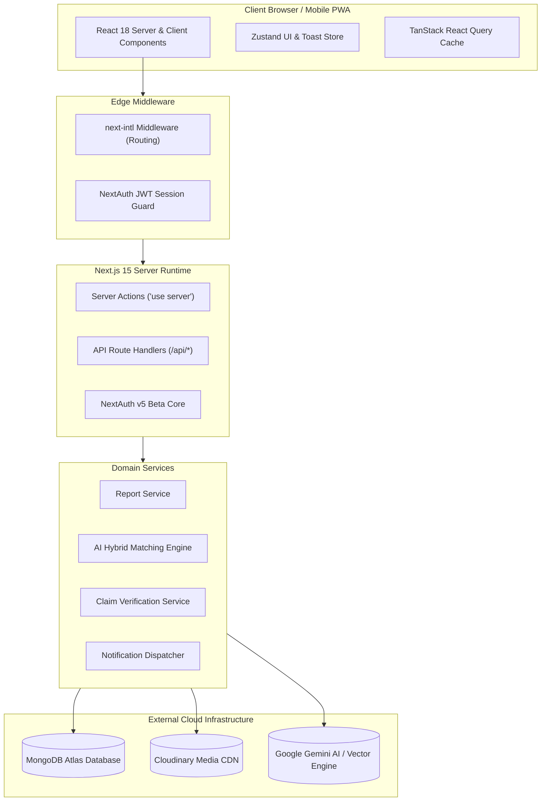
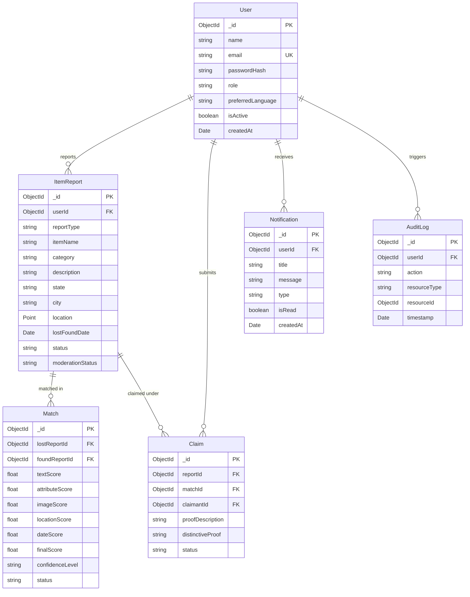

# FoundIt — Pan-India Lost & Found AI Matching Platform
> **Next-Generation Intelligent Public Goods Infrastructure for Locating and Reuniting Lost Belongings Across India**

---

## 1. Project Introduction
**FoundIt** is an enterprise-grade, nation-scale digital lost and found platform developed for the Indian subcontinent. Built on the modern Next.js 15 App Router architecture with TypeScript, Tailwind CSS, MongoDB, and Next-Gen AI embeddings, FoundIt bridges the critical disconnect between citizens who have lost valuable items and the citizens, transport authorities, police desks, and transit hubs who find them.

By utilizing multi-signal hybrid artificial intelligence (semantic vector embeddings, lexical character/token analysis, categorical attribute matching, geospatial radius calculation, and temporal decay modeling), FoundIt continuously scans nationwide reports to automatically match and alert owners in real-time.

---

## 2. Problem Statement
Every year, millions of high-value and sensitive personal items—such as wallets, identity credentials (Aadhaar, PAN, Passport, Driving Licenses), laptops, smartphones, keys, and heirloom jewelry—are misplaced across India's airports, Indian Railways stations, metro systems, temples, educational institutions, and public thoroughfares.

Traditional methods of handling lost property face severe systemic challenges:
1. **Extreme Fragmentation**: Transit agencies (e.g. DMRC, Mumbai Local, IRCTC), airports (AAI, private terminals), local police stations, and universities all maintain isolated, offline paper registers or siloed social media pages.
2. **Zero Interoperability**: An item lost on an interstate train departing New Delhi and arriving in Bengaluru cannot be tracked across jurisdictions.
3. **Language Barriers**: India’s linguistic diversity means reports in Hindi, English, and regional vernaculars fail to correlate on standard keyword-based portals.
4. **Fraud and Lack of Verification**: Conventional bulletin boards expose private serial numbers and marks, enabling bad actors to falsely claim expensive electronics.
5. **Human Resource Bottlenecks**: Overburdened transit staff lack automated tools to compare hundreds of daily arrivals against lost complaints.

---

## 3. Project Objectives
1. **Centralized Pan-India Network**: Provide a unified platform accessible across all 36 Indian States and Union Territories with granular city and locality categorization.
2. **Multi-Signal AI Matching Engine**: Implement a hybrid similarity algorithm combining lexical n-gram scoring, high-dimensional semantic text embeddings, visual feature comparison, geospatial Haversine proximity, and temporal delta decay.
3. **Bilingual Accessibility**: Deliver full internationalization (English and Hindi) to ensure seamless accessibility for diverse citizen demographics.
4. **Secure Ownership Claim Verification Protocol**: Enforce zero-knowledge verification where claimants must provide distinctive non-public proof (e.g., hidden marks, internal contents, IMEI/serial prefixes) before an item is released.
5. **Real-time Cross-Platform Notifications**: Automatically alert both parties and administrative reviewers upon detection of candidate matches scoring above dynamic threshold boundaries.
6. **Role-Based Governance and Auditability**: Provide specialized moderation interfaces and append-only cryptographic-style audit logs to prevent fraud, theft, and unauthorized custody releases.

---

## 4. Proposed Solution
FoundIt resolves nationwide fragmentation through a centralized, cloud-native web platform that acts as an intelligent matchmaker:
- **Instant Citizen Reporting**: Intuitive multi-step report submission with client-side image optimization, location auto-detection, and category taxonomies.
- **Continuous AI Vector Ingestion**: When a new report is filed, it is vectorized and compared against complementary active listings (LOST against FOUND, and vice versa).
- **Match Pipeline**: The hybrid scoring engine generates a composite confidence score between 0.00 and 1.00. Matches exceeding 0.70 trigger high-priority alerts with transparent visual score cards explaining *why* the items match.
- **Secure Custody Handshake**: When an owner confirms a match, they enter a structured claim flow where private evidence is vetted by moderators or custodian authorities prior to physical reunion.

---

## 5. Technology Stack

| Layer | Technology | Version | Purpose |
| :--- | :--- | :--- | :--- |
| **Framework** | Next.js (App Router) | 15.0.3 | Fullstack React framework, Server Components & Server Actions |
| **Language** | TypeScript | 5.7+ | Strict end-to-end type safety |
| **UI & Styling** | Tailwind CSS | 3.4+ | Utility-first styling with custom Stitch design tokens |
| **Icons** | Lucide React | 0.468+ | Accessible SVG icon suite |
| **Client State** | Zustand | 5.0+ | Lightweight reactive global UI and notification state |
| **Server State** | TanStack React Query | 5.62+ | Asynchronous server data synchronization and cache management |
| **Database** | MongoDB & Mongoose | 8.8+ | Document store with 2dsphere spatial indexing & text search |
| **Authentication** | NextAuth.js (Auth.js) | 5.0-beta.25 | JWT-based authentication, role authorization, session callbacks |
| **Security** | bcryptjs | 2.4+ | Blowfish crypt password hashing (12 salt rounds) |
| **Media Pipeline** | Cloudinary v2 SDK & Sharp | 2.5+ / 0.33+ | Cloud image storage, on-the-fly transformations & compression |
| **Validation** | Zod | 3.23+ | Runtime schema validation shared between client & server |
| **Forms** | React Hook Form | 7.53+ | High-performance uncontrolled form handling with Zod resolvers |
| **Internationalization** | next-intl | 3.25+ | Strict locale routing (`/en`, `/hi`) and server-side translations |
| **Visualizations** | Recharts | 2.14+ | Admin analytics, trend charts, category distributions |

---

## 6. System Architecture



---

## 7. Module Descriptions
1. **Authentication & Identity (`src/features/auth`, `src/lib/auth.ts`)**:
   - Credentials provider with bcrypt hash comparison.
   - JWT sessions containing role (`user`, `moderator`, `admin`) and `preferredLanguage`.
   - Protected routes guarded at edge middleware and server action boundary.
2. **Reports Management (`src/features/reports`, `src/app/[locale]/report/`)**:
   - Dedicated workflows for "Lost Item" and "Found Item" submissions.
   - 3-step wizard: Basic Details → Spatial/Temporal Tracking → Image Verification.
   - GPS coordinate capture and 36-State Indian Administrative classification.
3. **AI Hybrid Matching Engine (`src/services/matching/`, `src/services/ai/`)**:
   - Multi-factor evaluation across Text, Categorical Attributes, Images, Distance, and Time.
   - Background matching worker invoked automatically upon report creation.
4. **Ownership Claims Subsystem (`src/features/claims`, `src/app/[locale]/dashboard/claims`)**:
   - Structured claim form requesting public provenance and private distinct markers.
   - Multi-step status lifecycle: `pending` → `under_review` → `approved`/`rejected` → `resolved`.
5. **Real-time Notifications (`src/services/notifications`, `src/hooks/use-notifications.ts`)**:
   - Push and polling-based notification hub with unread indicators and badge counters.
   - Automated alerts on AI matches, status transitions, and administrative resolutions.
6. **Admin & Moderation Portal (`src/features/admin`, `src/app/[locale]/admin/`)**:
   - Role-restricted (`admin`) operations dashboard.
   - User privilege escalation/deactivation, report approval/rejection queues, and claim audits.
   - Interactive metric visualizers powered by Recharts.

---

## 8. Database Schema Explanation



---

## 9. AI Matching Methodology & Scoring Formula

The matching engine uses a **Multi-Signal Hybrid Fusion Algorithm** designed specifically for real-world lost and found items. Unlike naive keyword search or standalone embeddings, FoundIt scores five orthogonal dimensions:

$$FinalScore = (W_{text} \times S_{text}) + (W_{attr} \times S_{attr}) + (W_{img} \times S_{img}) + (W_{loc} \times S_{loc}) + (W_{date} \times S_{date})$$

### Baseline Feature Weights:
- **Text Similarity ($W_{text} = 0.35$)**: Hybrid token n-gram overlap + 768-dimensional semantic cosine similarity between descriptions.
- **Attribute Similarity ($W_{attr} = 0.20$)**: Exact and fuzzy equality across Category, Subcategory, Brand, and Color arrays.
- **Visual Similarity ($W_{img} = 0.20$)**: Cosine similarity between image embeddings generated by vision models.
- **Geospatial Proximity ($W_{loc} = 0.15$)**: Inverse exponential decay based on Haversine distance:
  $$S_{loc} = e^{-\frac{d}{d_{scale}}}$$
  (Where $d$ is distance in km and $d_{scale} = 50\text{ km}$).
- **Temporal Proximity ($W_{date} = 0.10$)**: Gaussian decay based on elapsed days between lost and found dates:
  $$S_{date} = \max\left(0, 1 - \frac{|\Delta days|}{30}\right)$$

> **Dynamically Renormalized Weights (When images are omitted)**:
> If an item report has no uploaded images, the weights are automatically renormalized across the remaining 4 features to prevent unfair penalty:
> - $W_{text} = 0.4375$
> - $W_{attr} = 0.2500$
> - $W_{loc} = 0.1875$
> - $W_{date} = 0.1250$

---

## 10. API Documentation

| Method | Endpoint | Auth Required | Description |
| :--- | :--- | :--- | :--- |
| `POST` | `/api/auth/register` | No | Creates a new user profile with hashed credentials |
| `POST` | `/api/auth/[...nextauth]` | No | Handles login, OAuth callbacks, and session destruction |
| `GET` | `/api/search` | No | Public catalog search with spatial, temporal, and category filters |
| `POST` | `/api/reports` | User | Submits a new lost or found item report |
| `GET` | `/api/reports/[id]` | No | Retrieves public details of a single report |
| `PATCH` | `/api/reports/[id]` | Owner / Admin | Updates details of an existing report |
| `DELETE`| `/api/reports/[id]` | Owner / Admin | Deletes an item report |
| `GET` | `/api/matches` | User | Fetches AI matches belonging to the logged-in user |
| `PATCH` | `/api/matches/[id]` | User | Accepts, rejects, or marks a match resolved |
| `POST` | `/api/claims` | User | Submits an ownership claim with evidence |
| `GET` | `/api/claims` | User | Lists all claims filed by the active user |
| `GET` | `/api/notifications` | User | Fetches user notifications and unread counter |
| `PATCH` | `/api/notifications/[id]/read` | User | Marks an individual notification as read |
| `GET` | `/api/admin/stats` | Admin | Fetches nationwide platform analytics |
| `GET` | `/api/admin/reports` | Admin | Fetches moderation queue reports |
| `PATCH` | `/api/admin/reports` | Admin | Approves or rejects reports with reason |
| `POST` | `/api/upload` | User | Uploads an image buffer directly to Cloudinary CDN |

---

## 11. Installation Instructions

### Prerequisites
- Node.js `v20.x` or `v24.x`
- npm `v10.x` or `v11.x`
- MongoDB local daemon or MongoDB Atlas connection string
- Cloudinary Account (for media uploads)

### Step 1: Clone and Navigate
```powershell
git clone <repository-url> c:\Project1
cd c:\Project1
```

### Step 2: Install Dependencies
```powershell
npm install
```

---

## 12. Environment Setup Guide
Create a `.env.local` file in the project root:
```env
# Database Connection
MONGODB_URI=mongodb://localhost:27017/lost-and-found

# NextAuth Authentication (v5 Beta)
NEXTAUTH_URL=http://localhost:3000
NEXTAUTH_SECRET=super-secret-development-key-change-this-in-production-min32chars
AUTH_SECRET=super-secret-development-key-change-this-in-production-min32chars

# Cloudinary Storage
CLOUDINARY_CLOUD_NAME=your_cloud_name
CLOUDINARY_API_KEY=your_api_key
CLOUDINARY_API_SECRET=your_api_secret

# AI & Embeddings
GEMINI_API_KEY=your_google_gemini_api_key

# Public App URL
NEXT_PUBLIC_APP_URL=http://localhost:3000
NODE_ENV=development
```

---

## 13. Local Development Instructions
Start the development server:
```powershell
npm run dev
```
Open [http://localhost:3000](http://localhost:3000) in your browser. The platform will automatically redirect to the localized root:
- English: `http://localhost:3000/en`
- Hindi: `http://localhost:3000/hi`

---

## 14. Testing Instructions
To perform TypeScript type checking and validation:
```powershell
npx tsc --noEmit
```

To run linting:
```powershell
npm run lint
```

To test production compilation:
```powershell
npm run build
```

---

## 15. Deployment Guide

### Deploying on Vercel
1. Push your repository to GitHub or GitLab.
2. Link the repository to your [Vercel Dashboard](https://vercel.com).
3. In **Settings → Environment Variables**, add all keys from `.env.local`.
4. Deploy with framework preset set to **Next.js**.

### MongoDB Atlas Setup
1. Create a free M0 cluster on MongoDB Atlas.
2. Under **Network Access**, whitelist your Vercel IP ranges (or `0.0.0.0/0`).
3. Under **Database Access**, create a user and copy the connection string into `MONGODB_URI`.

---

## 16. Security Considerations
- **Password Protection**: Passwords are never stored in plaintext; hashed with bcrypt using 12 salt rounds.
- **Zero-Knowledge Verification**: Secret identifying marks (e.g., serial numbers, wallpaper pictures, engravings) are flagged `select: false` in the database to prevent exposure to non-privileged users.
- **Edge Route Protection**: Unauthorized access to dashboard and admin paths is blocked before rendering via Next.js Edge Middleware.
- **Audit Logging**: All sensitive mutations (role modifications, claim resolutions, account suspensions) generate immutable records with IP address and timestamps in the `AuditLog` collection.
- **Input Sanitization**: All incoming payloads are strictly parsed and validated against Zod schemas on the server boundary.

---

## 17. Future Enhancements
1. **DigiLocker Integration**: Verification of government documents directly via official DigiLocker APIs.
2. **Police Portal Bridge**: Automatic sync with state police FIR and Lost Property portals.
3. **Voice-Assisted Reporting**: Multilingual voice-to-text reporting for rural and non-literate citizens.
4. **Offline Mobile PWA**: Service workers enabling local cache storage and offline draft creation.

---

## 18. Syllabus & Academic Mapping Table

| Academic Concept | Next.js / React 18 Implementation | File / Feature Reference |
| :--- | :--- | :--- |
| **Server Components (RSC)** | Server-side data fetching with zero bundle impact | `src/app/[locale]/page.tsx`, `admin/page.tsx` |
| **Server Actions** | Progressive enhancement mutations with `'use server'` | `src/features/reports/actions.ts`, `claims/actions.ts` |
| **Edge Middleware** | Pre-rendering session interception & localization | `src/middleware.ts` |
| **Dynamic Routing** | Nested segments & route groups `[locale]`, `(public)` | `src/app/[locale]/(public)/reports/[id]/` |
| **Client Hooks** | Custom encapsulated state and network hooks | `src/hooks/use-reports.ts`, `use-matches.ts` |
| **Reactive Stores** | Unidirectional global state with Zustand | `src/stores/ui-store.ts` |
| **Internationalization** | App Router i18n routing & dictionary retrieval | `src/i18n/routing.ts`, `src/i18n/request.ts` |
| **Relational & Spatial DB** | Compound, Text, and 2dsphere GeoJSON indexes | `src/models/ItemReport.ts`, `src/lib/mongodb.ts` |
| **Mathematical Modeling** | Haversine distance, decay curves, cosine similarity | `src/services/matching/matcher.ts`, `src/lib/utils.ts` |

---

## 19. License & Academic Attribution
Developed as an advanced capstone project demonstrating fullstack cloud engineering, artificial intelligence integration, and public service digital infrastructure. Built for India with ❤️.
